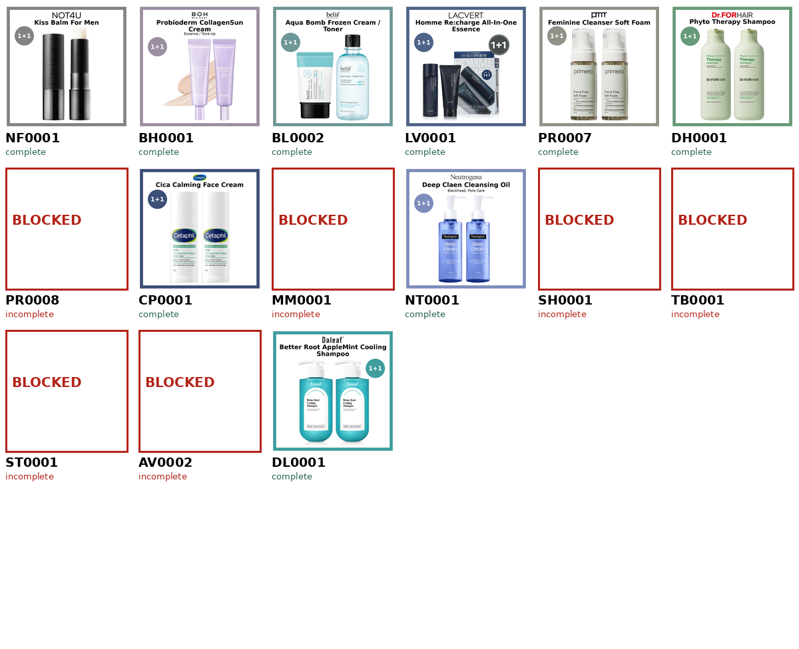

# 전체 상품 검수 목록

완료 상태는 catalog-state.json의 최종 검증 결과입니다. incomplete는 누락·불일치·디자인 검수 문제가 남은 항목입니다.

| 품명 | 상태 | 대표 PNG | 옵션 | ZIP |
|---|---|---|---|---|
| RL0001 | complete | [보기](../../output/RL0001/thumbnail.png) | [2개](../../output/RL0001/options) | [다운로드](../../archives/RL0001.zip) |
| MP0001 | complete | [보기](../../output/MP0001/thumbnail.png) | [2개](../../output/MP0001/options) | [다운로드](../../archives/MP0001.zip) |
| LL0001 | complete | [보기](../../output/LL0001/thumbnail.png) | [2개](../../output/LL0001/options) | [다운로드](../../archives/LL0001.zip) |
| SN0001 | complete | [보기](../../output/SN0001/thumbnail.png) | [2개](../../output/SN0001/options) | [다운로드](../../archives/SN0001.zip) |
| WM0001 | complete | [보기](../../output/WM0001/thumbnail.png) | [3개](../../output/WM0001/options) | [다운로드](../../archives/WM0001.zip) |
| GF0001 | incomplete | 미제작 | [8개](../../output/GF0001/options) | [다운로드](../../archives/GF0001.zip) |
| KL0001 | complete | [보기](../../output/KL0001/thumbnail.png) | [3개](../../output/KL0001/options) | [다운로드](../../archives/KL0001.zip) |
| ET0001 | incomplete | 미제작 | [5개](../../output/ET0001/options) | [다운로드](../../archives/ET0001.zip) |
| RL0002 | complete | [보기](../../output/RL0002/thumbnail.png) | [2개](../../output/RL0002/options) | [다운로드](../../archives/RL0002.zip) |
| GA0001 | complete | [보기](../../output/GA0001/thumbnail.png) | [2개](../../output/GA0001/options) | [다운로드](../../archives/GA0001.zip) |
| CM0001 | complete | [보기](../../output/CM0001/thumbnail.png) | [2개](../../output/CM0001/options) | [다운로드](../../archives/CM0001.zip) |
| MP0002 | complete | [보기](../../output/MP0002/thumbnail.png) | [2개](../../output/MP0002/options) | [다운로드](../../archives/MP0002.zip) |
| IC0001 | incomplete | [보기](../../output/IC0001/thumbnail.png) | [2개](../../output/IC0001/options) | [다운로드](../../archives/IC0001.zip) |
| CQ0001 | complete | [보기](../../output/CQ0001/thumbnail.png) | [2개](../../output/CQ0001/options) | [다운로드](../../archives/CQ0001.zip) |
| MD0001 | complete | [보기](../../output/MD0001/thumbnail.png) | [11개](../../output/MD0001/options) | [다운로드](../../archives/MD0001.zip) |
| BD0001 | complete | [보기](../../output/BD0001/thumbnail.png) | [2개](../../output/BD0001/options) | [다운로드](../../archives/BD0001.zip) |
| IM0001 | complete | [보기](../../output/IM0001/thumbnail.png) | [3개](../../output/IM0001/options) | [다운로드](../../archives/IM0001.zip) |
| IM0002 | complete | [보기](../../output/IM0002/thumbnail.png) | [3개](../../output/IM0002/options) | [다운로드](../../archives/IM0002.zip) |
| BN0001 | complete | [보기](../../output/BN0001/thumbnail.png) | [2개](../../output/BN0001/options) | [다운로드](../../archives/BN0001.zip) |
| BN0002 | incomplete | 미제작 | [4개](../../output/BN0002/options) | [다운로드](../../archives/BN0002.zip) |
| CL0001 | complete | [보기](../../output/CL0001/thumbnail.png) | [11개](../../output/CL0001/options) | [다운로드](../../archives/CL0001.zip) |
| CL0002 | complete | [보기](../../output/CL0002/thumbnail.png) | [16개](../../output/CL0002/options) | [다운로드](../../archives/CL0002.zip) |
| HY0001 | complete | [보기](../../output/HY0001/thumbnail.png) | [2개](../../output/HY0001/options) | [다운로드](../../archives/HY0001.zip) |
| PR0001 | complete | [보기](../../output/PR0001/thumbnail.png) | [2개](../../output/PR0001/options) | [다운로드](../../archives/PR0001.zip) |
| BL0001 | complete | [보기](../../output/BL0001/thumbnail.png) | [6개](../../output/BL0001/options) | [다운로드](../../archives/BL0001.zip) |
| DS0001 | complete | [보기](../../output/DS0001/thumbnail.png) | [2개](../../output/DS0001/options) | [다운로드](../../archives/DS0001.zip) |
| AD0001 | incomplete | 미제작 | [4개](../../output/AD0001/options) | [다운로드](../../archives/AD0001.zip) |
| WM0002 | incomplete | 미제작 | [9개](../../output/WM0002/options) | [다운로드](../../archives/WM0002.zip) |
| RL0003 | complete | [보기](../../output/RL0003/thumbnail.png) | [2개](../../output/RL0003/options) | [다운로드](../../archives/RL0003.zip) |
| TS0001 | complete | [보기](../../output/TS0001/thumbnail.png) | [2개](../../output/TS0001/options) | [다운로드](../../archives/TS0001.zip) |
| YM0001 | complete | [보기](../../output/YM0001/thumbnail.png) | [2개](../../output/YM0001/options) | [다운로드](../../archives/YM0001.zip) |
| HB0001 | complete | [보기](../../output/HB0001/thumbnail.png) | [3개](../../output/HB0001/options) | [다운로드](../../archives/HB0001.zip) |
| SN0002 | complete | [보기](../../output/SN0002/thumbnail.png) | [2개](../../output/SN0002/options) | [다운로드](../../archives/SN0002.zip) |
| ME0001 | incomplete | 미제작 | [2개](../../output/ME0001/options) | [다운로드](../../archives/ME0001.zip) |
| AH0001 | complete | [보기](../../output/AH0001/thumbnail.png) | [2개](../../output/AH0001/options) | [다운로드](../../archives/AH0001.zip) |
| TR0001 | complete | [보기](../../output/TR0001/thumbnail.png) | [2개](../../output/TR0001/options) | [다운로드](../../archives/TR0001.zip) |
| RL0004 | complete | [보기](../../output/RL0004/thumbnail.png) | [2개](../../output/RL0004/options) | [다운로드](../../archives/RL0004.zip) |
| TR0002 | complete | [보기](../../output/TR0002/thumbnail.png) | [2개](../../output/TR0002/options) | [다운로드](../../archives/TR0002.zip) |
| NV0001 | complete | [보기](../../output/NV0001/thumbnail.png) | [2개](../../output/NV0001/options) | [다운로드](../../archives/NV0001.zip) |
| IN0001 | complete | [보기](../../output/IN0001/thumbnail.png) | [2개](../../output/IN0001/options) | [다운로드](../../archives/IN0001.zip) |
| RB0001 | complete | [보기](../../output/RB0001/thumbnail.png) | [2개](../../output/RB0001/options) | [다운로드](../../archives/RB0001.zip) |
| PR0002 | complete | [보기](../../output/PR0002/thumbnail.png) | [4개](../../output/PR0002/options) | [다운로드](../../archives/PR0002.zip) |
| GA0002 | complete | [보기](../../output/GA0002/thumbnail.png) | [2개](../../output/GA0002/options) | [다운로드](../../archives/GA0002.zip) |
| EU0001 | incomplete | 미제작 | [2개](../../output/EU0001/options) | [다운로드](../../archives/EU0001.zip) |
| CF0001 | complete | [보기](../../output/CF0001/thumbnail.png) | [5개](../../output/CF0001/options) | [다운로드](../../archives/CF0001.zip) |
| DQ0001 | complete | [보기](../../output/DQ0001/thumbnail.png) | [2개](../../output/DQ0001/options) | [다운로드](../../archives/DQ0001.zip) |
| HY0002 | incomplete | 미제작 | [2개](../../output/HY0002/options) | [다운로드](../../archives/HY0002.zip) |
| AN0001 | complete | [보기](../../output/AN0001/thumbnail.png) | [2개](../../output/AN0001/options) | [다운로드](../../archives/AN0001.zip) |
| SF0001 | complete | [보기](../../output/SF0001/thumbnail.png) | [2개](../../output/SF0001/options) | [다운로드](../../archives/SF0001.zip) |
| DG0001 | complete | [보기](../../output/DG0001/thumbnail.png) | [2개](../../output/DG0001/options) | [다운로드](../../archives/DG0001.zip) |
| RM0001 | complete | [보기](../../output/RM0001/thumbnail.png) | [9개](../../output/RM0001/options) | [다운로드](../../archives/RM0001.zip) |
| ET0002 | incomplete | [보기](../../output/ET0002/thumbnail.png) | [2개](../../output/ET0002/options) | [다운로드](../../archives/ET0002.zip) |
| IN0002 | complete | [보기](../../output/IN0002/thumbnail.png) | [3개](../../output/IN0002/options) | [다운로드](../../archives/IN0002.zip) |
| PT0001 | complete | [보기](../../output/PT0001/thumbnail.png) | [2개](../../output/PT0001/options) | [다운로드](../../archives/PT0001.zip) |
| BP0001 | complete | [보기](../../output/BP0001/thumbnail.png) | [3개](../../output/BP0001/options) | [다운로드](../../archives/BP0001.zip) |
| TR0003 | complete | [보기](../../output/TR0003/thumbnail.png) | [6개](../../output/TR0003/options) | [다운로드](../../archives/TR0003.zip) |
| CN0001 | complete | [보기](../../output/CN0001/thumbnail.png) | [2개](../../output/CN0001/options) | [다운로드](../../archives/CN0001.zip) |
| LL0002 | complete | [보기](../../output/LL0002/thumbnail.png) | [2개](../../output/LL0002/options) | [다운로드](../../archives/LL0002.zip) |
| ET0003 | complete | [보기](../../output/ET0003/thumbnail.png) | [1개](../../output/ET0003/options) | [다운로드](../../archives/ET0003.zip) |
| AB0001 | incomplete | 미제작 | [2개](../../output/AB0001/options) | [다운로드](../../archives/AB0001.zip) |
| WM0003 | complete | [보기](../../output/WM0003/thumbnail.png) | [3개](../../output/WM0003/options) | [다운로드](../../archives/WM0003.zip) |
| MZ0001 | complete | [보기](../../output/MZ0001/thumbnail.png) | [2개](../../output/MZ0001/options) | [다운로드](../../archives/MZ0001.zip) |
| PR0003 | complete | [보기](../../output/PR0003/thumbnail.png) | [5개](../../output/PR0003/options) | [다운로드](../../archives/PR0003.zip) |
| BY0001 | complete | [보기](../../output/BY0001/thumbnail.png) | [2개](../../output/BY0001/options) | [다운로드](../../archives/BY0001.zip) |
| HB0002 | complete | [보기](../../output/HB0002/thumbnail.png) | [2개](../../output/HB0002/options) | [다운로드](../../archives/HB0002.zip) |
| DJ0001 | complete | [보기](../../output/DJ0001/thumbnail.png) | [2개](../../output/DJ0001/options) | [다운로드](../../archives/DJ0001.zip) |
| DJ0002 | complete | [보기](../../output/DJ0002/thumbnail.png) | [2개](../../output/DJ0002/options) | [다운로드](../../archives/DJ0002.zip) |
| GR0001 | complete | [보기](../../output/GR0001/thumbnail.png) | [6개](../../output/GR0001/options) | [다운로드](../../archives/GR0001.zip) |
| IM0003 | complete | [보기](../../output/IM0003/thumbnail.png) | [3개](../../output/IM0003/options) | [다운로드](../../archives/IM0003.zip) |
| ND0001 | complete | [보기](../../output/ND0001/thumbnail.png) | [1개](../../output/ND0001/options) | [다운로드](../../archives/ND0001.zip) |
| HP0001 | complete | [보기](../../output/HP0001/thumbnail.png) | [3개](../../output/HP0001/options) | [다운로드](../../archives/HP0001.zip) |
| LT0001 | complete | [보기](../../output/LT0001/thumbnail.png) | [3개](../../output/LT0001/options) | [다운로드](../../archives/LT0001.zip) |
| SL0001 | complete | [보기](../../output/SL0001/thumbnail.png) | [2개](../../output/SL0001/options) | [다운로드](../../archives/SL0001.zip) |
| DK0001 | complete | [보기](../../output/DK0001/thumbnail.png) | [1개](../../output/DK0001/options) | [다운로드](../../archives/DK0001.zip) |
| PR0004 | complete | [보기](../../output/PR0004/thumbnail.png) | [2개](../../output/PR0004/options) | [다운로드](../../archives/PR0004.zip) |
| DF0001 | incomplete | 미제작 | [3개](../../output/DF0001/options) | [다운로드](../../archives/DF0001.zip) |
| SN0003 | complete | [보기](../../output/SN0003/thumbnail.png) | [2개](../../output/SN0003/options) | [다운로드](../../archives/SN0003.zip) |
| CS0001 | complete | [보기](../../output/CS0001/thumbnail.png) | [9개](../../output/CS0001/options) | [다운로드](../../archives/CS0001.zip) |
| DW0001 | complete | [보기](../../output/DW0001/thumbnail.png) | [10개](../../output/DW0001/options) | [다운로드](../../archives/DW0001.zip) |
| EU0002 | complete | [보기](../../output/EU0002/thumbnail.png) | [2개](../../output/EU0002/options) | [다운로드](../../archives/EU0002.zip) |
| SP0001 | complete | [보기](../../output/SP0001/thumbnail.png) | [2개](../../output/SP0001/options) | [다운로드](../../archives/SP0001.zip) |
| BP0002 | complete | [보기](../../output/BP0002/thumbnail.png) | [4개](../../output/BP0002/options) | [다운로드](../../archives/BP0002.zip) |
| MS0001 | complete | [보기](../../output/MS0001/thumbnail.png) | [2개](../../output/MS0001/options) | [다운로드](../../archives/MS0001.zip) |
| AV0001 | complete | [보기](../../output/AV0001/thumbnail.png) | [3개](../../output/AV0001/options) | [다운로드](../../archives/AV0001.zip) |
| DJ0003 | complete | [보기](../../output/DJ0003/thumbnail.png) | [2개](../../output/DJ0003/options) | [다운로드](../../archives/DJ0003.zip) |
| KB0001 | complete | [보기](../../output/KB0001/thumbnail.png) | [22개](../../output/KB0001/options) | [다운로드](../../archives/KB0001.zip) |
| SN0004 | complete | [보기](../../output/SN0004/thumbnail.png) | [2개](../../output/SN0004/options) | [다운로드](../../archives/SN0004.zip) |
| SN0005 | complete | [보기](../../output/SN0005/thumbnail.png) | [2개](../../output/SN0005/options) | [다운로드](../../archives/SN0005.zip) |
| AS0001 | complete | [보기](../../output/AS0001/thumbnail.png) | [4개](../../output/AS0001/options) | [다운로드](../../archives/AS0001.zip) |
| BF0001 | complete | [보기](../../output/BF0001/thumbnail.png) | [4개](../../output/BF0001/options) | [다운로드](../../archives/BF0001.zip) |
| TR0004 | complete | [보기](../../output/TR0004/thumbnail.png) | [2개](../../output/TR0004/options) | [다운로드](../../archives/TR0004.zip) |
| BB0001 | complete | [보기](../../output/BB0001/thumbnail.png) | [15개](../../output/BB0001/options) | [다운로드](../../archives/BB0001.zip) |
| AT0001 | complete | [보기](../../output/AT0001/thumbnail.png) | [6개](../../output/AT0001/options) | [다운로드](../../archives/AT0001.zip) |
| AM0001 | complete | [보기](../../output/AM0001/thumbnail.png) | [2개](../../output/AM0001/options) | [다운로드](../../archives/AM0001.zip) |
| MX0001 | complete | [보기](../../output/MX0001/thumbnail.png) | [2개](../../output/MX0001/options) | [다운로드](../../archives/MX0001.zip) |
| CK0001 | complete | [보기](../../output/CK0001/thumbnail.png) | [3개](../../output/CK0001/options) | [다운로드](../../archives/CK0001.zip) |
| HY0003 | incomplete | 미제작 | [2개](../../output/HY0003/options) | [다운로드](../../archives/HY0003.zip) |
| CR0001 | complete | [보기](../../output/CR0001/thumbnail.png) | [4개](../../output/CR0001/options) | [다운로드](../../archives/CR0001.zip) |
| HM0001 | complete | [보기](../../output/HM0001/thumbnail.png) | [5개](../../output/HM0001/options) | [다운로드](../../archives/HM0001.zip) |
| BP0003 | complete | [보기](../../output/BP0003/thumbnail.png) | [2개](../../output/BP0003/options) | [다운로드](../../archives/BP0003.zip) |
| KM0001 | complete | [보기](../../output/KM0001/thumbnail.png) | [2개](../../output/KM0001/options) | [다운로드](../../archives/KM0001.zip) |
| IM0004 | complete | [보기](../../output/IM0004/thumbnail.png) | [1개](../../output/IM0004/options) | [다운로드](../../archives/IM0004.zip) |
| CN0002 | complete | [보기](../../output/CN0002/thumbnail.png) | [2개](../../output/CN0002/options) | [다운로드](../../archives/CN0002.zip) |
| GV0001 | complete | [보기](../../output/GV0001/thumbnail.png) | [4개](../../output/GV0001/options) | [다운로드](../../archives/GV0001.zip) |
| ET0004 | complete | [보기](../../output/ET0004/thumbnail.png) | [3개](../../output/ET0004/options) | [다운로드](../../archives/ET0004.zip) |
| ET0005 | complete | [보기](../../output/ET0005/thumbnail.png) | [2개](../../output/ET0005/options) | [다운로드](../../archives/ET0005.zip) |
| NC0001 | incomplete | 미제작 | [3개](../../output/NC0001/options) | [다운로드](../../archives/NC0001.zip) |
| BP0004 | complete | [보기](../../output/BP0004/thumbnail.png) | [1개](../../output/BP0004/options) | [다운로드](../../archives/BP0004.zip) |
| RV0001 | complete | [보기](../../output/RV0001/thumbnail.png) | [4개](../../output/RV0001/options) | [다운로드](../../archives/RV0001.zip) |
| RM0002 | complete | [보기](../../output/RM0002/thumbnail.png) | [4개](../../output/RM0002/options) | [다운로드](../../archives/RM0002.zip) |
| PP0001 | complete | [보기](../../output/PP0001/thumbnail.png) | [4개](../../output/PP0001/options) | [다운로드](../../archives/PP0001.zip) |
| MB0001 | complete | [보기](../../output/MB0001/thumbnail.png) | [6개](../../output/MB0001/options) | [다운로드](../../archives/MB0001.zip) |
| PR0005 | complete | [보기](../../output/PR0005/thumbnail.png) | [2개](../../output/PR0005/options) | [다운로드](../../archives/PR0005.zip) |
| GA0003 | complete | [보기](../../output/GA0003/thumbnail.png) | [2개](../../output/GA0003/options) | [다운로드](../../archives/GA0003.zip) |
| HG0001 | complete | [보기](../../output/HG0001/thumbnail.png) | [2개](../../output/HG0001/options) | [다운로드](../../archives/HG0001.zip) |
| EU0003 | complete | [보기](../../output/EU0003/thumbnail.png) | [2개](../../output/EU0003/options) | [다운로드](../../archives/EU0003.zip) |
| HH0001 | complete | [보기](../../output/HH0001/thumbnail.png) | [5개](../../output/HH0001/options) | [다운로드](../../archives/HH0001.zip) |
| IS0001 | complete | [보기](../../output/IS0001/thumbnail.png) | [6개](../../output/IS0001/options) | [다운로드](../../archives/IS0001.zip) |
| CN0003 | complete | [보기](../../output/CN0003/thumbnail.png) | [2개](../../output/CN0003/options) | [다운로드](../../archives/CN0003.zip) |
| BC0001 | complete | [보기](../../output/BC0001/thumbnail.png) | [2개](../../output/BC0001/options) | [다운로드](../../archives/BC0001.zip) |
| ET0006 | complete | [보기](../../output/ET0006/thumbnail.png) | [2개](../../output/ET0006/options) | [다운로드](../../archives/ET0006.zip) |
| BW0001 | complete | [보기](../../output/BW0001/thumbnail.png) | [2개](../../output/BW0001/options) | [다운로드](../../archives/BW0001.zip) |
| TR0005 | complete | [보기](../../output/TR0005/thumbnail.png) | [2개](../../output/TR0005/options) | [다운로드](../../archives/TR0005.zip) |
| SC0001 | complete | [보기](../../output/SC0001/thumbnail.png) | [2개](../../output/SC0001/options) | [다운로드](../../archives/SC0001.zip) |
| CK0002 | complete | [보기](../../output/CK0002/thumbnail.png) | [2개](../../output/CK0002/options) | [다운로드](../../archives/CK0002.zip) |
| BR0001 | complete | [보기](../../output/BR0001/thumbnail.png) | [4개](../../output/BR0001/options) | [다운로드](../../archives/BR0001.zip) |
| ET0007 | complete | [보기](../../output/ET0007/thumbnail.png) | [2개](../../output/ET0007/options) | [다운로드](../../archives/ET0007.zip) |
| CN0004 | complete | [보기](../../output/CN0004/thumbnail.png) | [2개](../../output/CN0004/options) | [다운로드](../../archives/CN0004.zip) |
| TR0006 | complete | [보기](../../output/TR0006/thumbnail.png) | [1개](../../output/TR0006/options) | [다운로드](../../archives/TR0006.zip) |
| DM0001 | complete | [보기](../../output/DM0001/thumbnail.png) | [2개](../../output/DM0001/options) | [다운로드](../../archives/DM0001.zip) |
| EU0004 | complete | [보기](../../output/EU0004/thumbnail.png) | [2개](../../output/EU0004/options) | [다운로드](../../archives/EU0004.zip) |
| JS0001 | complete | [보기](../../output/JS0001/thumbnail.png) | [2개](../../output/JS0001/options) | [다운로드](../../archives/JS0001.zip) |
| GA0004 | complete | [보기](../../output/GA0004/thumbnail.png) | [2개](../../output/GA0004/options) | [다운로드](../../archives/GA0004.zip) |
| BP0005 | complete | [보기](../../output/BP0005/thumbnail.png) | [1개](../../output/BP0005/options) | [다운로드](../../archives/BP0005.zip) |
| DW0002 | complete | [보기](../../output/DW0002/thumbnail.png) | [2개](../../output/DW0002/options) | [다운로드](../../archives/DW0002.zip) |
| WM0004 | complete | [보기](../../output/WM0004/thumbnail.png) | [15개](../../output/WM0004/options) | [다운로드](../../archives/WM0004.zip) |
| AW0001 | complete | [보기](../../output/AW0001/thumbnail.png) | [2개](../../output/AW0001/options) | [다운로드](../../archives/AW0001.zip) |
| TH0001 | complete | [보기](../../output/TH0001/thumbnail.png) | [2개](../../output/TH0001/options) | [다운로드](../../archives/TH0001.zip) |
| AC0001 | complete | [보기](../../output/AC0001/thumbnail.png) | [2개](../../output/AC0001/options) | [다운로드](../../archives/AC0001.zip) |
| LS0001 | complete | [보기](../../output/LS0001/thumbnail.png) | [3개](../../output/LS0001/options) | [다운로드](../../archives/LS0001.zip) |
| SM0001 | complete | [보기](../../output/SM0001/thumbnail.png) | [15개](../../output/SM0001/options) | [다운로드](../../archives/SM0001.zip) |
| CU0001 | complete | [보기](../../output/CU0001/thumbnail.png) | [2개](../../output/CU0001/options) | [다운로드](../../archives/CU0001.zip) |
| DJ0004 | incomplete | 미제작 | [3개](../../output/DJ0004/options) | [다운로드](../../archives/DJ0004.zip) |
| PR0006 | complete | [보기](../../output/PR0006/thumbnail.png) | [8개](../../output/PR0006/options) | [다운로드](../../archives/PR0006.zip) |
| BC0002 | complete | [보기](../../output/BC0002/thumbnail.png) | [2개](../../output/BC0002/options) | [다운로드](../../archives/BC0002.zip) |
| HY0004 | complete | [보기](../../output/HY0004/thumbnail.png) | [2개](../../output/HY0004/options) | [다운로드](../../archives/HY0004.zip) |
| AR0001 | complete | [보기](../../output/AR0001/thumbnail.png) | [3개](../../output/AR0001/options) | [다운로드](../../archives/AR0001.zip) |
| IF0001 | incomplete | 미제작 | [2개](../../output/IF0001/options) | [다운로드](../../archives/IF0001.zip) |
| BY0002 | complete | [보기](../../output/BY0002/thumbnail.png) | [1개](../../output/BY0002/options) | [다운로드](../../archives/BY0002.zip) |
| ET0008 | complete | [보기](../../output/ET0008/thumbnail.png) | [2개](../../output/ET0008/options) | [다운로드](../../archives/ET0008.zip) |
| BP0006 | complete | [보기](../../output/BP0006/thumbnail.png) | [2개](../../output/BP0006/options) | [다운로드](../../archives/BP0006.zip) |
| BG0001 | complete | [보기](../../output/BG0001/thumbnail.png) | [4개](../../output/BG0001/options) | [다운로드](../../archives/BG0001.zip) |
| IM0005 | incomplete | 미제작 | [2개](../../output/IM0005/options) | [다운로드](../../archives/IM0005.zip) |
| AC0002 | complete | [보기](../../output/AC0002/thumbnail.png) | [2개](../../output/AC0002/options) | [다운로드](../../archives/AC0002.zip) |
| OE0001 | complete | [보기](../../output/OE0001/thumbnail.png) | [1개](../../output/OE0001/options) | [다운로드](../../archives/OE0001.zip) |
| CX0001 | complete | [보기](../../output/CX0001/thumbnail.png) | [2개](../../output/CX0001/options) | [다운로드](../../archives/CX0001.zip) |
| DO0001 | incomplete | 미제작 | [2개](../../output/DO0001/options) | [다운로드](../../archives/DO0001.zip) |
| EL0001 | complete | [보기](../../output/EL0001/thumbnail.png) | [5개](../../output/EL0001/options) | [다운로드](../../archives/EL0001.zip) |
| LK0001 | complete | [보기](../../output/LK0001/thumbnail.png) | [8개](../../output/LK0001/options) | [다운로드](../../archives/LK0001.zip) |
| DJ0005 | complete | [보기](../../output/DJ0005/thumbnail.png) | [2개](../../output/DJ0005/options) | [다운로드](../../archives/DJ0005.zip) |
| CK0003 | complete | [보기](../../output/CK0003/thumbnail.png) | [2개](../../output/CK0003/options) | [다운로드](../../archives/CK0003.zip) |
| EN0001 | complete | [보기](../../output/EN0001/thumbnail.png) | [6개](../../output/EN0001/options) | [다운로드](../../archives/EN0001.zip) |
| DN0001 | complete | [보기](../../output/DN0001/thumbnail.png) | [2개](../../output/DN0001/options) | [다운로드](../../archives/DN0001.zip) |
| MX0002 | complete | [보기](../../output/MX0002/thumbnail.png) | [2개](../../output/MX0002/options) | [다운로드](../../archives/MX0002.zip) |
| RP0001 | incomplete | 미제작 | [2개](../../output/RP0001/options) | [다운로드](../../archives/RP0001.zip) |
| DW0003 | complete | [보기](../../output/DW0003/thumbnail.png) | [2개](../../output/DW0003/options) | [다운로드](../../archives/DW0003.zip) |
| SO0001 | complete | [보기](../../output/SO0001/thumbnail.png) | [2개](../../output/SO0001/options) | [다운로드](../../archives/SO0001.zip) |
| RC0001 | complete | [보기](../../output/RC0001/thumbnail.png) | [5개](../../output/RC0001/options) | [다운로드](../../archives/RC0001.zip) |
| NF0001 | complete | [보기](../../output/NF0001/thumbnail.png) | [2개](../../output/NF0001/options) | [다운로드](../../archives/NF0001.zip) |
| BH0001 | complete | [보기](../../output/BH0001/thumbnail.png) | [4개](../../output/BH0001/options) | [다운로드](../../archives/BH0001.zip) |
| BL0002 | complete | [보기](../../output/BL0002/thumbnail.png) | [4개](../../output/BL0002/options) | [다운로드](../../archives/BL0002.zip) |
| LV0001 | complete | [보기](../../output/LV0001/thumbnail.png) | [1개](../../output/LV0001/options) | [다운로드](../../archives/LV0001.zip) |
| PR0007 | complete | [보기](../../output/PR0007/thumbnail.png) | [2개](../../output/PR0007/options) | [다운로드](../../archives/PR0007.zip) |
| DH0001 | complete | [보기](../../output/DH0001/thumbnail.png) | [3개](../../output/DH0001/options) | [다운로드](../../archives/DH0001.zip) |
| PR0008 | complete | [보기](../../output/PR0008/thumbnail.png) | [5개](../../output/PR0008/options) | [다운로드](../../archives/PR0008.zip) |
| CP0001 | complete | [보기](../../output/CP0001/thumbnail.png) | [2개](../../output/CP0001/options) | [다운로드](../../archives/CP0001.zip) |
| MM0001 | complete | [보기](../../output/MM0001/thumbnail.png) | [2개](../../output/MM0001/options) | [다운로드](../../archives/MM0001.zip) |
| NT0001 | complete | [보기](../../output/NT0001/thumbnail.png) | [2개](../../output/NT0001/options) | [다운로드](../../archives/NT0001.zip) |
| SH0001 | incomplete | 미제작 | [2개](../../output/SH0001/options) | [다운로드](../../archives/SH0001.zip) |
| TB0001 | complete | [보기](../../output/TB0001/thumbnail.png) | [2개](../../output/TB0001/options) | [다운로드](../../archives/TB0001.zip) |
| ST0001 | complete | [보기](../../output/ST0001/thumbnail.png) | [2개](../../output/ST0001/options) | [다운로드](../../archives/ST0001.zip) |
| AV0002 | complete | [보기](../../output/AV0002/thumbnail.png) | [2개](../../output/AV0002/options) | [다운로드](../../archives/AV0002.zip) |
| DL0001 | complete | [보기](../../output/DL0001/thumbnail.png) | [2개](../../output/DL0001/options) | [다운로드](../../archives/DL0001.zip) |
